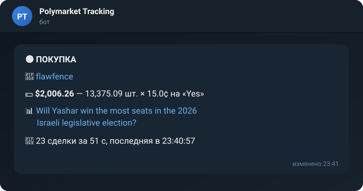

<div align="center">

# Polymarket Tracking Bot

**Сигналы в Telegram в реальном времени, когда кошельки, за которыми ты следишь, торгуют на [Polymarket](https://polymarket.com).**

[](https://github.com/SergeyZheskiy/polymarket_tracking_bot/actions/workflows/ci.yml)


[](LICENSE)

[English](README.md) · Русский



</div>

## Возможности

- **Быстро.** Сделки приходят из живого потока биржи, обычно через 1–3 секунды
  после сделки. Раз в 20 секунд бот дополнительно сверяется с историей
  кошельков, чтобы ничего не потерять при обрыве связи.
- **Без спама.** Крупную заявку часто исполняют десятки встречных сделок.
  Бот присылает одно сообщение на серию, а дальше обновляет в нём сумму,
  среднюю цену и число сделок. Новых уведомлений на телефон при этом нет.
- **Доступ под контролем.** Бот работает по приглашению: незнакомец жмёт
  `/start`, а админу приходит заявка с кнопками «Разрешить» и «Отклонить».
  Есть админ-панель `/admin`. Бот можно сделать открытым (`open: true`).
- **Без ключей Polymarket.** Используются только публичные API.

## Быстрый старт

Нужен Python 3.10+.

```bash
git clone https://github.com/SergeyZheskiy/polymarket_tracking_bot.git
cd polymarket_tracking_bot
pip install -r requirements.txt

cp .env.example .env                  # впиши токен бота и свой id в ADMINS
cp wallets.example.txt wallets.txt    # впиши кошельки
python notifier.py
```

1. Токен бота выдаёт [@BotFather](https://t.me/BotFather): команда `/newbot`.
2. Свой id в Telegram узнаешь так: оставь `ADMINS` пустым, запусти бота
   и напиши ему `/start`. Бот напечатает в консоли `заявка на доступ: ..., id 123456789`.
   Впиши этот id в `ADMINS` и перезапусти бота.

## Кошельки

`wallets.txt` — по одному на строку: адрес `0x…` или ссылка на профиль.

```
0x2005d16a84ceefa912d4e380cd32e7ff827875ea   # RN1
https://polymarket.com/@swisstony
https://polymarket.com/ru/@gopfan2?tab=activity
```

Бот перечитывает файл каждые 5 секунд, перезапуск не нужен. Из Telegram
список поменять нельзя, это сделано специально.

## Команды в Telegram

| Кто | Команда | Что делает |
|---|---|---|
| все с доступом | `/start` | включить сигналы |
| | `/stop` | выключить сигналы |
| админ | `/admin` | панель: пользователи, заявки, подписчики, кнопки «Убрать» и «Разрешить» |
| | `/adduser ID имя` | дать доступ вручную |
| | `/deluser ID` | забрать доступ |

## Настройки

Всё в [config.yaml](config.yaml) с комментариями:

| Параметр | По умолчанию | Что значит |
|---|---|---|
| `open` | `false` | `true` — пускать всех без заявок |
| `min_usdc` | `0` | не присылать серии дешевле этой суммы, $ |
| `merge_minutes` | `10` | сделки в один исход с паузой меньше этой идут одним сообщением |
| `group_seconds` | `3` | сколько копить сделки перед отправкой |
| `poll_seconds` | `20` | как часто сверяться с историей кошельков (`0` — выключить) |

## Запуск на сервере (24/7)

Боту нужен компьютер, который всегда включён. Хватит самого дешёвого
VPS с Ubuntu. Проще всего запускать через Docker: бот сам перезапустится
после сбоя или перезагрузки сервера.

```bash
git clone https://github.com/SergeyZheskiy/polymarket_tracking_bot.git
cd polymarket_tracking_bot
cp .env.example .env && nano .env
cp wallets.example.txt wallets.txt && nano wallets.txt

docker compose up -d --build
docker compose logs -f                          # смотреть логи
```

Обновить бота после изменений на GitHub:

```bash
git pull && docker compose up -d --build
```

## Файлы

```
notifier.py          сделки -> сигналы: поток, опрос, склейка серий, запуск
panel.py             Telegram: подписчики, доступ, админ-панель
polymarket.py        клиент к публичным API Polymarket
tests/               тесты (без сети)
config.yaml          настройки
wallets.txt          твои кошельки (не в git)
.env                 токены и id админов (не в git)
data/                подписчики и пользователи (не в git)
```

## Разработка

```bash
pip install pytest ruff
pytest        # тесты работают без сети
ruff check .
```

## Важно

Проект не связан с Polymarket. Сигналы носят информационный характер и не
являются финансовой рекомендацией. Прошлая доходность кошелька не гарантирует
будущую.

## Лицензия

[MIT](LICENSE)
